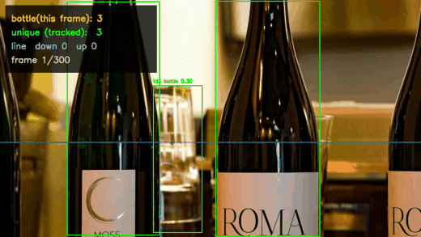
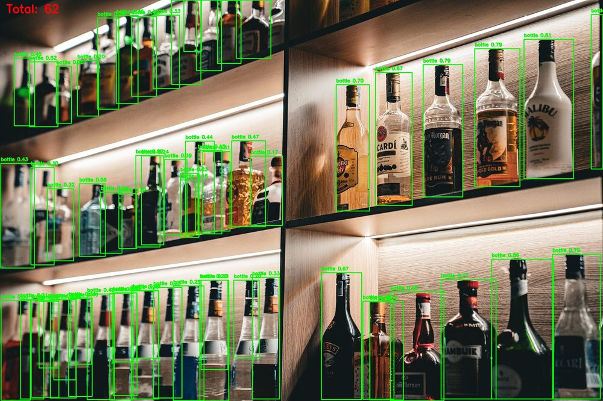
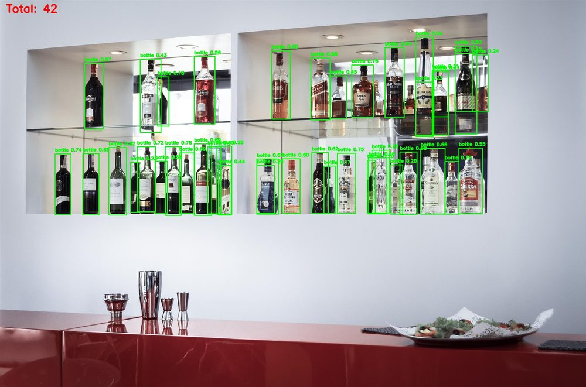
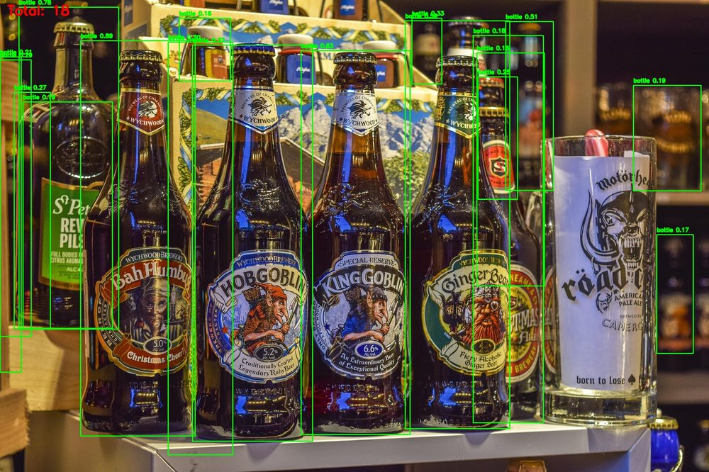

# 视觉智能计数系统

基于 **YOLOv8 + ByteTrack** 的目标计数工具：输入一张图、一个文件夹或一段视频，输出检测框、实时计数、**跟踪去重数**与**过线统计**。

默认数**瓶子**（COCO 第 39 类），换 `--target car` 就能数车，COCO 80 类里任意目标都支持。纯 CPU 可运行。



*演示片段为 5 段瓶子场景拼接。左上角面板实时显示：本帧检出数 / 跟踪去重数 / 过线上下 / 帧进度*

---

## 效果

| 货架场景 → 62 个 | 酒柜场景 → 42 个 | 桌面场景 → 18 个 |
|---|---|---|
|  |  |  |

24 张测试图的检出数量：

| 图 | img10 | img13 | img01 | img09 | img11 | img03 | img08 | img24 |
|---|---|---|---|---|---|---|---|---|
| 检出 | 62 | 42 | 18 | 14 | 9 | 8 | 5 | 5 |

**视频实测**（`bottle_walk.mp4`，10 秒 / 300 帧 / 1280×720 @30fps）：

| 指标 | 数值 | 说明 |
|---|---|---|
| 逐帧累加 | 2716 次 | 直接逐帧数会重复计数，不能当结果 |
| **跟踪去重后** | **65 个 ID** | 真正有意义的数字（但见「已知问题」第 2 条） |
| 单帧最多 | 44 个 | 出现在第 181 帧 |
| 过线 | 向下 5 / 向上 3 | 计数线位于画面高度 60% 处 |

---

## 关键设计

**1. 类别双保险。** 只数 `bottle`：推理时传 `classes=[39]` 让模型不去算其余 79 类（顺带更快），每个框再回查一次类别名确认。杯子、花瓶、酒架这类相近物体因此不会混进来。

**2. 阈值 0.15 是试出来的，不是拍的。** 瓶子透明、反光多、常被遮挡，模型置信度普遍偏低。实测 0.4 时一排瓶子会漏掉好几个，0.05 时背景高光和瓶身反光又被当成瓶子。0.15 是漏检与误检之间的折中点，可用 `scripts/probe_conf.py` 复现这组对比。

**3. 视频必须用跟踪去重，不能逐帧累加。** 同一个瓶子在连续帧里会被反复检出，直接累加得到 2716 次；`model.track(persist=True, tracker="bytetrack.yaml")` 让同一目标在多帧间保持同一个 ID，再用 ID 集合去重，才得到"一共出现过几个"。

**4. 输入尺寸 640。** 让远处的小瓶子也能进网络，代价是偶尔多算一两个，可以接受。

---

## 快速开始

```bash
git clone https://github.com/xxh666umr/visual-counting-system.git
cd visual-counting-system

pip install -r requirements.txt

# 用仓库自带的 4 张示例图跑
python main.py samples
```

其他用法：

```bash
python main.py                                  # 默认：data/images + data/videos 全套
python main.py 单张图片.jpg                     # 只跑一张图
python main.py data/images                      # 只跑一个文件夹
python main.py data/videos/xx.mp4 --show        # 跑视频 + 实时弹窗预览（Esc 退出）
python main.py --target car --conf 0.25         # 数汽车 / 改阈值
python main.py --model runs/train/weights/best.pt   # 换自己训练的模型
```

**关于权重**：项目根目录的 `yolov8n.pt` 不入库（6.4 MB）。首次运行若本地没有，ultralytics 会自动下载官方权重；也可以手动下载后放到项目根目录：

```
https://github.com/ultralytics/assets/releases/download/v8.2.0/yolov8n.pt
```

---

## 输出

结果全部写在 `output/`：

| 文件 | 说明 |
|---|---|
| `<图片名>.jpg` | 带检测框与总数的结果图 |
| `<视频名>_count.mp4` | 带实时计数面板的结果视频 |
| `<视频名>_counts.csv` | 逐帧数据（帧号 / 本帧数 / 去重数 / 过线上下），Excel 可直接打开 |
| `<视频名>_summary.json` | 统计摘要（总数、峰值、均值、过线数） |

CSV 用 `utf-8-sig` 编码，避免 Excel 打开中文乱码。

---

## 项目结构

```
visual-counting-system/
├── main.py                  # 入口：argparse 参数解析 + 任务分发
├── config.py                # 全局配置（dataclass，参数集中管理）
├── core/
│   ├── detector.py          # YOLO 检测器封装（惰性加载 / 类别解析 / 跟踪）
│   ├── counter.py           # 图片计数 + 视频计数（跟踪去重 / 过线统计）
│   ├── visualizer.py        # 画框 / 半透明面板 / 计数线
│   └── io_utils.py          # 中文路径读写 / CSV / JSON 导出
├── scripts/
│   ├── label_tool.py        # 离线标注工具（YOLO 格式，支持中文路径）
│   ├── make_demo_video.py   # 演示视频生成器（Ken Burns 运镜）
│   ├── train_custom.py      # 自定义目标微调训练
│   └── probe_conf.py        # 置信度阈值探索实验
├── samples/                 # 4 张示例图，clone 下来可直接跑
├── docs/images/             # README 配图
├── data/                    # 本地数据（不入库）
├── output/                  # 运行结果（不入库）
├── requirements.txt
└── LICENSE
```

---

## 已知问题与限制

这一节是项目里最有信息量的部分——每一条都对应一次实际调试。

**1. 中文路径读不了图。** 早期 `cv2.imread` 在含中文的路径下稳定返回 `None`。改成 `np.fromfile` 读字节 + `cv2.imdecode` 解码，写图同理用 `cv2.imencode` + `tofile`。`core/io_utils.py` 统一封装。

**2. 跟踪 ID 在场景切换时会被重新分配。** 演示视频是 5 段场景硬接的蒙太奇，每次画面全变，ByteTrack 只能给同一批瓶子分配新 ID，所以 `unique = 65` 约等于各段之和，**不是真有 65 个不同的瓶子**。换成一段连续拍摄的视频就没有这个问题。

**3. 过线计数触发得少。** 运镜以推近、拉远、左右平移为主，瓶子在竖直方向位移不够，穿线次数自然少（向下 5、向上 3）。把中段改成上下摇镜头才有足够穿越。

**4. 有一类瓶子稳定漏检。** 躺倒的瓶子、插画风格的瓶子、暗调静物里的酒瓶、海边逆光下的啤酒瓶。这是预训练模型对非标准姿态与画风的固有短板，调阈值救不了，只能靠自训练或数据增强——这正是 `scripts/train_custom.py` 存在的意义。

**5. 画面上文字会糊成一片。** 一排几十个瓶子时，每个框都写 `id + 类别 + 置信度`，小框上的字会叠在一起。加了 `MIN_LABEL_W = 70`：框宽不足 70 像素就只画框不写字。面板不透明度也从 0.55 提到 0.78，避免检测框的小字透上来和数字打架。

**6. 阈值经过多轮试错。** 0.4 漏检严重 → 0.05 误检严重 → 最终定在 0.15。

---

## 关于模型

**本项目的检测模型是 Ultralytics 官方预训练权重 `yolov8n.pt`，没有自行训练。**

这是一个明确的选择，不是偷懒：`bottle` 本来就在 COCO 的 80 个标注类别里，预训练权重已经学过它；要自己训练得标注几百张图，精度未必更高。工程上把时间花在计数逻辑、跟踪去重和异常处理上，收益更大。

如果要数 COCO 里没有的目标（特定的零件、包装、缺陷），才需要走自训练路线，用 `scripts/train_custom.py`。

---

## 开发说明

代码在 AI 辅助下完成初稿，本人在此基础上完成场景选材、参数调试、模块拆分与重构、逐项功能测试，并能逐行解释实现细节。

---

## License

[MIT](LICENSE)
